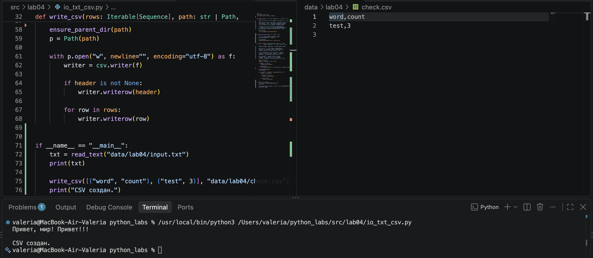
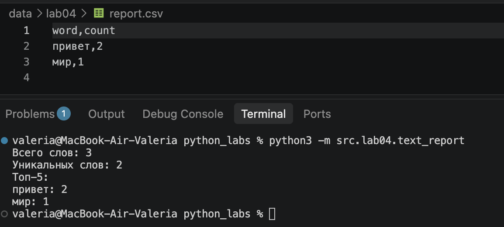

# Лабораторная работа №3

## Задание A: io_txt_csv

В файле `src/lab04/io_txt_csv.py` реализованы функции для чтения и записи данных. Функция `read_text` считывает содержимое текстового файла с использованием заданной кодировки (по умолчанию `UTF-8`). При отсутствии файла или ошибке декодирования возникают исключения `FileNotFoundError` и `UnicodeDecodeError`. Функция `write_csv` сохраняет данные в `CSV` с разделителем , и при необходимости добавляет заголовок. Перед сохранением проверяется количество элементов в строках и заголовке. При несовпадении вызывается `ValueError`. Если папка для сохранения отсутствует, она создаётся автоматически.

```python
import csv
from pathlib import Path
from typing import Iterable, Sequence


def read_text(path: str | Path, encoding: str = "utf-8") -> str:
    """
    Читает содержимое текстового файла и возвращает его строкой.

    path указывает расположение файла, а encoding определяет
    кодировку для чтения. По умолчанию используется UTF-8,
    но при необходимости можно указать encoding="cp1251".

    Если файл отсутствует, возникает FileNotFoundError.
    При неправильной кодировке возникает UnicodeDecodeError.
    Если файл пустой, функция возвращает пустую строку.
    """
    p = Path(path)
    return p.read_text(encoding=encoding)


def ensure_parent_dir(path: str | Path) -> None:
    """
    Проверяет наличие папок по указанному пути.
    Если нужных папок нет, создаёт их.
    """
    p = Path(path)
    p.parent.mkdir(parents=True, exist_ok=True)


def write_csv(rows: Iterable[Sequence], path: str | Path,
              header: tuple[str, ...] | None = None) -> None:
    """
    Создаёт CSV-файл и записывает в него переданные данные.

    rows содержит строки для записи, path указывает,
    где будет сохранён файл. Параметр header позволяет
    добавить заголовки столбцов в первую строку.

    Перед сохранением проверяется количество элементов
    в каждой строке. Если длины различаются, возникает
    ValueError. Длина заголовка также проверяется.

    Если rows пустой, создаётся пустой CSV-файл
    или файл только с заголовком, если он указан.
    При повторной записи старые данные заменяются новыми.
    """
    rows = list(rows)
    lengths = {len(row) for row in rows}

    if header is not None:
        lengths.add(len(header))

    if len(lengths) > 1:
        raise ValueError("Все строки должны иметь одинаковую длину")

    ensure_parent_dir(path)
    p = Path(path)

    with p.open("w", newline="", encoding="utf-8") as f:
        writer = csv.writer(f)

        if header is not None:
            writer.writerow(header)

        for row in rows:
            writer.writerow(row)


if __name__ == "__main__":
    txt = read_text("data/lab04/input.txt")
    print(txt)

    write_csv([("word", "count"), ("test", 3)], "data/lab04/check.csv")
    print("CSV создан.")

```

## Задание B: text_report

В файле `src/lab04/text_report.py` реализована программа для анализа содержимого текстового файла. Пути к исходному файлу и CSV-отчёту указаны в коде `(data/lab04/input.txt)` и `(data/lab04/report.csv)`, используется кодировка `UTF-8`.

С помощью функций из `src/lib/text.py` текст приводится к единому виду, разделяется на слова и подсчитывается частота их повторений. Полученные данные записываются в `CSV-файл` с колонками `word,count`. Слова сортируются по убыванию количества повторений, а при одинаковой частоте — по алфавиту.

В терминале отображаются общее число слов, количество уникальных слов и пять наиболее часто встречающихся слов. Если исходный файл отсутствует, программа выводит сообщение об ошибке и прекращает выполнение.

```python
from src.lib.text import normalize, tokenize, count_freq, top_n
from src.lab04.io_txt_csv import read_text, write_csv


def main() -> None:
    """
    Читает текстовый файл, считает частоты слов,
    сохраняет отчёт в CSV и выводит статистику.
    """

    try:
        raw_text = read_text("data/lab04/input.txt", encoding="utf-8")
    except FileNotFoundError:
        print("Ошибка: файл не найден")
        raise SystemExit(1)

    text = normalize(raw_text)
    tokens = tokenize(text)
    freq = count_freq(tokens)

    total_words = len(tokens)
    unique_words = len(freq)

    all_rows = sorted(freq.items(), key=lambda x: (-x[1], x[0]))
    top5 = top_n(freq, n=5)

    write_csv(all_rows, "data/lab04/report.csv", header=("word", "count"))

    print(f"Всего слов: {total_words}")
    print(f"Уникальных слов: {unique_words}")
    print("Топ-5:")

    for word, count in top5:
        print(f"{word}: {count}")


if __name__ == "__main__":
    main()
```


## Способ запуска text_report.py
Для запуска программы необходимо открыть терминал в корневой папке проекта `python_labs` и выполнить команду:
```bash
python -m src.lab04.text_report
```
После запуска программа считывает текст из `data/lab04/input.txt`, выводит статистику слов в терминал и сохраняет результаты в файл `data/lab04/report.csv`.