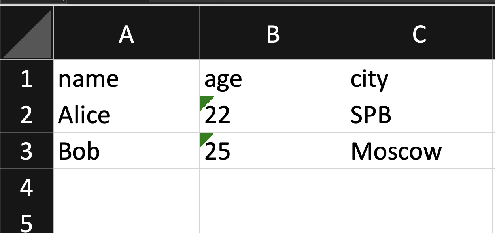
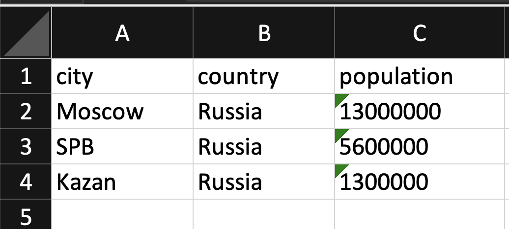

# Лабораторная работа №5

## Задание A: JSON ↔ CSV 
Файл: src/lab05/json_csv.py

В модуле находятся две функции для преобразования файлов.

`json_to_csv(json_path, csv_path)` — читает `JSON-файл`, содержащий список словарей, и записывает данные в `CSV`. Ключи словарей используются как названия столбцов, а каждый словарь записывается отдельной строкой. Если у какого-то словаря отсутствует нужный ключ, вместо значения записывается пустая строка.

`csv_to_json(csv_path, json_path)` — читает `CSV-файл` и преобразует его в `JSON`. Для чтения используется `csv.DictReader()`, который берёт названия ключей из первой строки `CSV`. Результат сохраняется с помощью `json.dump()` с параметрами `ensure_ascii=False` и `indent=2`.

В обеих функциях проверяются расширения файлов через `endswith()`. Также добавлены проверки на пустые файлы, неправильную структуру `JSON` и ошибки в `CSV`. При неправильных данных вызывается `ValueError`.

Для создания папок, в которые сохраняются результаты, используется `Path` и `mkdir()`.
```python
import json
import csv
from pathlib import Path


def json_to_csv(json_path: str, csv_path: str) -> None:
    """
    Преобразует JSON-файл в CSV.
    Поддерживает список словарей, заполняет отсутствующие поля пустыми строками.
    Кодировка UTF-8. Порядок колонок — по первому появлению ключей.
    """

    if not json_path.endswith(".json"):
        raise ValueError("Файл должен быть JSON")
    if not csv_path.endswith(".csv"):
        raise ValueError("Файл должен быть CSV")

    with open(json_path, "r", encoding="utf-8") as f:
        try:
            data = json.load(f)
        except json.JSONDecodeError:
            raise ValueError("Пустой JSON или неправильный формат")

    if not isinstance(data, list) or len(data) == 0:
        raise ValueError("Пустой JSON или неподдерживаемая структура")

    for item in data:
        if not isinstance(item, dict):
            raise ValueError("JSON должен содержать список словарей")

    columns = []
    for item in data:
        for key in item:
            if key not in columns:
                columns.append(key)

    if len(columns) == 0:
        raise ValueError("В JSON нет полей")

    path = Path(csv_path)
    path.parent.mkdir(parents=True, exist_ok=True)

    with path.open("w", newline="", encoding="utf-8") as f:
        writer = csv.DictWriter(f, fieldnames=columns)
        writer.writeheader()

        for item in data:
            row = {}
            for column in columns:
                row[column] = item.get(column, "")
            writer.writerow(row)

def csv_to_json(csv_path: str, json_path: str) -> None:
    """
    Преобразует CSV в JSON.
    Заголовок обязателен, значения сохраняются как строки.
    """
    if not json_path.endswith(".json"):
        raise ValueError("Файл должен быть JSON")
    if not csv_path.endswith(".csv"):
        raise ValueError("Файл должен быть CSV")

    with open(csv_path, "r", newline="", encoding="utf-8") as f:
        reader = csv.DictReader(f)

        if not reader.fieldnames:
             raise ValueError("CSV без заголовка")
        
        data = list(reader)
        for row in data:
             if None in row:
                 raise ValueError("Неверное количество столбцов CSV")

             for key in row:
                 if row[key] is None:
                     row[key] = ""

    if not data:
        raise ValueError("Пустой CSV")

    path = Path(json_path)
    path.parent.mkdir(parents=True, exist_ok=True)
    
    with open(json_path, "w", encoding="utf-8") as f:
         json.dump(data, f, ensure_ascii=False, indent=2)

           
if __name__ == "__main__":
    json_to_csv("data/samples/people.json", "data/out/people_from_json.csv")
    csv_to_json("data/samples/people.csv", "data/out/people_from_csv.json")
```

## Задание B: CSV → XLSX
Файл: src/lab05/csv_xlsx.py

Функция `csv_to_xlsx(csv_path, xlsx_path)` читает `CSV-файл` и сохраняет его содержимое в таблицу `Excel`.

Для чтения `CSV` используется `csv.reader()`, а для создания `XLSX-файла` — библиотека openpyxl.

Перед преобразованием проверяются расширения файлов, наличие заголовка и строк с данными, а также количество столбцов. Если данные неправильные, вызывается `ValueError`.

После проверки создаётся `Excel-файл` с листом `Sheet1`. Все строки переносятся в таблицу с помощью `ws.append()`.

Ширина столбцов подбирается автоматически по самому длинному значению. Для этого используются `get_column_letter()` и `column_dimensions`. Минимальная ширина получается равной 10.

Готовый файл сохраняется с помощью `wb.save()`. Если папка для результата отсутствует, она создаётся автоматически.
```python
import csv
from pathlib import Path
from openpyxl import Workbook
from openpyxl.utils import get_column_letter


def csv_to_xlsx(csv_path: str, xlsx_path: str) -> None:
    """
    Преобразует CSV-файл в XLSX.
    Первая строка CSV — заголовок.
    Лист называется Sheet1.
    Ширина колонок подстраивается под текст.
    """

    if not csv_path.endswith(".csv"):
        raise ValueError("Файл должен быть CSV")
    if not xlsx_path.endswith(".xlsx"):
        raise ValueError("Файл должен быть XLSX")

    with open(csv_path, "r", encoding="utf-8", newline="") as f:
        reader = csv.reader(f)
        rows = list(reader)

    if len(rows) < 2:
        raise ValueError("CSV пустой или содержит только заголовок")
    if not rows[0] or not any(rows[0]):
        raise ValueError("CSV без заголовка")

    for name in rows[0]:
        if not name:
            raise ValueError("Пустое название столбца")
    for row in rows:
        if len(row) != len(rows[0]):
            raise ValueError("Неверное количество столбцов CSV")

    wb = Workbook()
    ws = wb.active
    ws.title = "Sheet1"

    for row in rows:
        ws.append(row)
    for i in range(len(rows[0])):
        max_length = 8

        for row in rows:
            if len(row[i]) > max_length:
                max_length = len(row[i])
        letter = get_column_letter(i + 1)
        ws.column_dimensions[letter].width = max_length + 2

    path = Path(xlsx_path)
    path.parent.mkdir(parents=True, exist_ok=True)

    wb.save(path)

if __name__ == "__main__":
    csv_to_xlsx("data/samples/people.csv", "data/out/people.xlsx")
```

## Особенности преобразования

При преобразовании `JSON` в `CSV` порядок столбцов определяется появлением ключей в словарях. Сначала используются ключи первого словаря, затем добавляются новые ключи из остальных.

Если в `JSON` отсутствует какое-то поле, в `CSV`  вместо него записывается пустая строка.

При преобразовании `CSV` в `JSON` все значения сохраняются как строки. Например, 22 превращается в "22".

При преобразовании `CSV` в `XLSX` данные переносятся в таблицу без преобразования текстовых значений в числа.

Для чтения и записи текстовых файлов используется кодировка `UTF-8`.
Пути к файлам указываются относительно корневой папки `python_labs`.

## 1. JSON → CSV

Команда запуска: 
```bash
python3 -m src.lab05.json_csv
```
Функция `json_to_csv()` читает `data/samples/people.json` и создаёт `data/out/people_from_json.csv`.

**Вход `(data/samples/people.json)`:**
```python 
[
    {"name": "Alice", "age": 22},
    {"name": "Bob", "age": 25}
]
```
**Выход `(data/out/people_from_json.csv)`:**
```python
name,age
Alice,22
Bob,25
```
## 2. CSV → JSON

Команда запуска: 
```bash
python3 -m src.lab05.json_csv
```
Функция `csv_to_json()` читает `data/samples/people.csv` и создаёт `data/out/people_from_csv.json.`
**Вход `(data/samples/people.csv)`:**
```python 
name,age,city
Alice,22,SPB
Bob,25,Moscow
```
**Выход (data/out/people_from_csv.json):**
```python
[
    {
        "name": "Alice",
        "age": "22",
        "city": "SPB"
    },
    {
        "name": "Bob",
        "age": "25",
        "city": "Moscow"
    }
]
```
## 3. CSV → XLSX (people.csv)

Команда запуска: 
```bash
python3 -m src.lab05.csv_xlsx
```
Функция `csv_to_xlsx()` читает `data/samples/people.csv` и создаёт Excel-файл `data/out/people.xlsx`.
**Вход `Вход (data/samples/people.csv)`:**
```python 
name,age,city
Alice,22,SPB
Bob,25,Moscow
```
**Результат `(data/out/people.xlsx)`**


**Открытие Excel-файла на Mac:**
```bash
open data/out/people.xlsx
```
**Открытие Excel-файла на Windows(PowerShell)**
```bash
start data/out/people.xlsx
```
## 4. CSV → XLSX (cities.csv)
 
Для дополнительной проверки используется файл `data/samples/cities.csv`.

**Команда запуска:**
```bash
python3 -c 'from src.lab05.csv_xlsx import csv_to_xlsx; csv_to_xlsx("data/samples/cities.csv", "data/out/cities.xlsx")'
```
**Открытие Excel-файла на Mac:**
```bash
open data/out/cities.xlsx
```
**Открытие Excel-файла на Windows(PowerShell)**
```bash
start data/out/cities.xlsx
```

Также файлы можно открыть вручную через проводник, перейдя в папку `data/out/`.

**Пример входа `(data/samples/cities.csv)`:**
```python 
city,country,population
Moscow,Russia,13000000
SPB,Russia,5600000
Kazan,Russia,1300000
```
**Пример результата `(data/out/cities.xlsx)`:**
