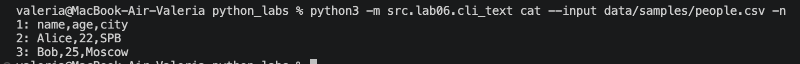
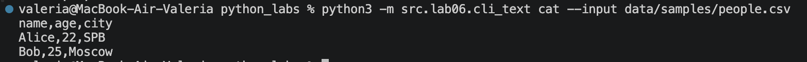
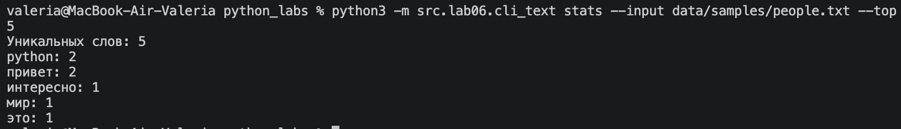
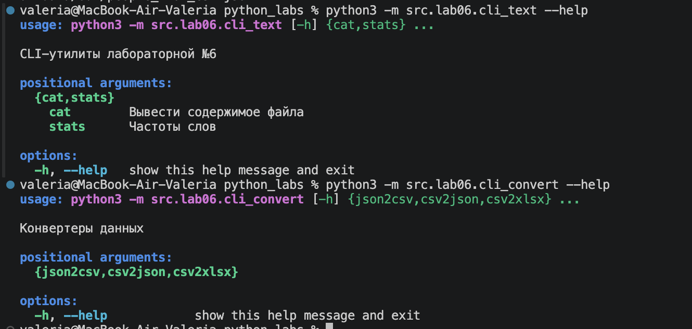
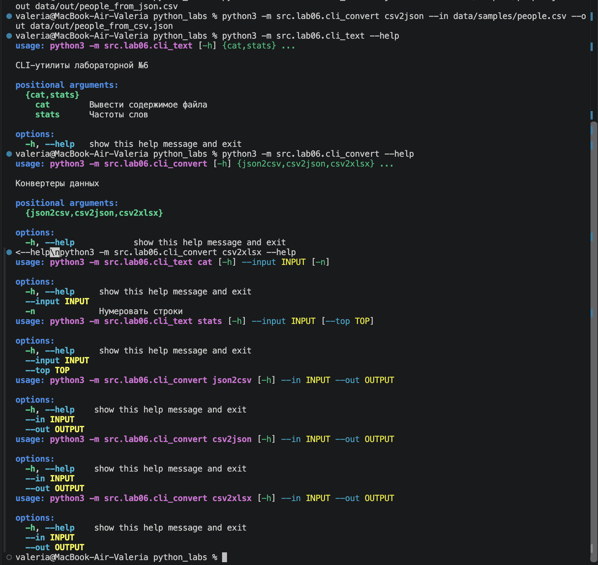
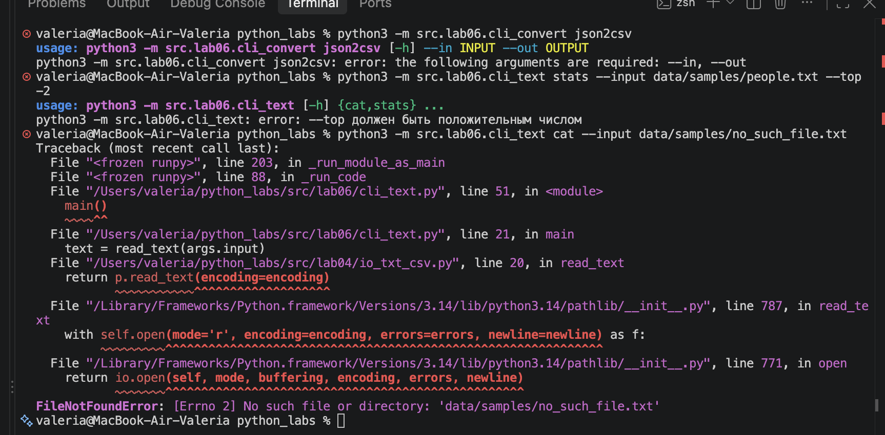

# Лабораторная работа №6

**CLI-утилиты с `argparse`: cat / stats + конвертеры JSON, CSV, XLSX**

## Цель работы

Научиться создавать консольные инструменты с аргументами командной строки, подкомандами и флагами. Существующие функции анализа текста (ЛР3, ЛР4) и конвертации данных (ЛР5) оборачиваются в CLI-оболочки с помощью модуля `argparse`.

Используется только стандартная библиотека Python (`argparse`, `os`, `pathlib`, `sys`) и функции из предыдущих лабораторных.

## Способ запуска

Все команды выполняются **из корневой папки `python_labs`** через терминал (например, в VS Code). Запуск модулей идёт через `python3 -m`, чтобы корректно работали импорты вида `from src.lab05...`:

```bash
python3 -m src.lab06.<модуль> <подкоманда> [параметры]
```

---

## Задание A. `cli_text.py`

Модуль работает с текстовыми файлами через командную строку и содержит две подкоманды: `cat` и `stats`.

### Подкоманды и параметры

| Подкоманда | Параметр | Обязательный | Описание |
|------------|----------|:------------:|----------|
| `cat` | `--input <путь>` | да | Путь к файлу, содержимое которого нужно вывести |
| `cat` | `-n` | нет | Флаг: нумеровать строки |
| `stats` | `--input <путь>` | да | Путь к текстовому файлу для анализа |
| `stats` | `--top N` | нет | Сколько самых частых слов выводить (по умолчанию `5`, должно быть > 0) |

**Как это работает:**

- `cat` читает файл функцией `read_text` (ЛР4), разбивает текст на строки и выводит их по одной. С флагом `-n` перед каждой строкой печатается её номер в формате `N: строка`.
- `stats` читает файл, приводит текст к нормальной форме (`normalize`), разбивает на слова (`tokenize`), считает частоты (`count_freq`) и выводит общее число слов, число уникальных слов и топ-N самых частых (`top_n`). Если `--top` меньше либо равно нулю, вызывается `parser.error(...)`.

### Код

```python
import argparse
from src.lab04.io_txt_csv import read_text
from src.lib.text import normalize, tokenize, count_freq, top_n


def main():
    parser = argparse.ArgumentParser(description="CLI-утилиты лабораторной №6")
    subparsers = parser.add_subparsers(dest="command")

    cat_parser = subparsers.add_parser("cat", help="Вывести содержимое файла")
    cat_parser.add_argument("--input", required=True)
    cat_parser.add_argument("-n", action="store_true", help="Нумеровать строки")

    stats_parser = subparsers.add_parser("stats", help="Частоты слов")
    stats_parser.add_argument("--input", required=True)
    stats_parser.add_argument("--top", type=int, default=5)

    args = parser.parse_args()

    if args.command == "cat":
        text = read_text(args.input)
        lines = text.splitlines()

        number = 1
        for line in lines:
            if args.n:
                print(f"{number}: {line}")
            else:
                print(line)
            number += 1

    elif args.command == "stats":
        if args.top <= 0:
            parser.error("--top должен быть положительным числом")

        text = read_text(args.input)
        text = normalize(text)
        tokens = tokenize(text)
        freq = count_freq(tokens)

        print(f"Всего слов: {len(tokens)}")
        print(f"Уникальных слов: {len(freq)}")

        top_words = top_n(freq, n=args.top)

        for word, count in top_words:
            print(f"{word}: {count}")


if __name__ == "__main__":
    main()
```

### Сценарии проверки

**1. `cat` — вывод содержимого файла с нумерацией строк**

```bash
python3 -m src.lab06.cli_text cat --input data/samples/people.csv -n
```



**2. `cat` — вывод содержимого файла без нумерации**

```bash
python3 -m src.lab06.cli_text cat --input data/samples/people.csv
```



**3. `stats` — подсчёт частоты слов (топ-5)**

```bash
python3 -m src.lab06.cli_text stats --input data/samples/people.txt --top 5
```

Формат вывода:

```text
Всего слов: <число>
Уникальных слов: <число>
<слово>: <частота>
... (ещё 4 строки)
```



---

## Задание B. `cli_convert.py`

Модуль преобразует файлы между форматами через командную строку и содержит три подкоманды: `json2csv`, `csv2json` и `csv2xlsx`. Для каждой подкоманды используются два обязательных параметра.

### Подкоманды и параметры

| Подкоманда | Параметры | Что делает | Функция (ЛР5) |
|------------|-----------|------------|---------------|
| `json2csv` | `--in <файл.json>` `--out <файл.csv>` | Преобразует JSON в CSV | `json_to_csv` |
| `csv2json` | `--in <файл.csv>` `--out <файл.json>` | Преобразует CSV в JSON | `csv_to_json` |
| `csv2xlsx` | `--in <файл.csv>` `--out <файл.xlsx>` | Создаёт Excel-файл из CSV | `csv_to_xlsx` |

Параметр `--in` сохраняется в `args.input`, а `--out` — в `args.output` (через `dest=`), так как `in` является зарезервированным словом Python.

### Код

```python
import argparse

from src.lab05.json_csv import json_to_csv, csv_to_json
from src.lab05.csv_xlsx import csv_to_xlsx


def main():
    parser = argparse.ArgumentParser(description="Конвертеры данных")
    sub = parser.add_subparsers(dest="cmd")

    p1 = sub.add_parser("json2csv")
    p1.add_argument("--in", dest="input", required=True)
    p1.add_argument("--out", dest="output", required=True)

    p2 = sub.add_parser("csv2json")
    p2.add_argument("--in", dest="input", required=True)
    p2.add_argument("--out", dest="output", required=True)

    p3 = sub.add_parser("csv2xlsx")
    p3.add_argument("--in", dest="input", required=True)
    p3.add_argument("--out", dest="output", required=True)

    args = parser.parse_args()

    if args.cmd == "json2csv":
        json_to_csv(args.input, args.output)
    elif args.cmd == "csv2json":
        csv_to_json(args.input, args.output)
    elif args.cmd == "csv2xlsx":
        csv_to_xlsx(args.input, args.output)


if __name__ == "__main__":
    main()
```

### Сценарии проверки

**1. `json2csv` — JSON в CSV**

```bash
python3 -m src.lab06.cli_convert json2csv --in data/samples/people.json --out data/out/people_from_json.csv
```

Создаётся файл `data/out/people_from_json.csv` с данными из исходного JSON.

**2. `csv2json` — CSV в JSON**

```bash
python3 -m src.lab06.cli_convert csv2json --in data/samples/people.csv --out data/out/people_from_csv.json
```

Создаётся файл `data/out/people_from_csv.json` с содержимым CSV в формате JSON.


**3. `csv2xlsx` — CSV в XLSX**

```bash
python3 -m src.lab06.cli_convert csv2xlsx --in data/samples/people.csv --out data/out/people.xlsx
```

Создаётся файл `data/out/people.xlsx`, который открывается в Excel или LibreOffice. Таблица содержит лист `Sheet1`, ширина столбцов подстраивается под содержимое.

---

## Проверка справки `--help`

Справка по модулям и доступным подкомандам:

```bash
python3 -m src.lab06.cli_text --help
python3 -m src.lab06.cli_convert --help
```



Справка по каждой подкоманде:

```bash
python3 -m src.lab06.cli_text cat --help
python3 -m src.lab06.cli_text stats --help
python3 -m src.lab06.cli_convert json2csv --help
python3 -m src.lab06.cli_convert csv2json --help
python3 -m src.lab06.cli_convert csv2xlsx --help
```



---

## Проверка ошибок

**Не переданы обязательные параметры** (`--input`, `--in`, `--out`). `argparse` сам выводит сообщение об ошибке и завершает программу:

```bash
python3 -m src.lab06.cli_convert json2csv
```

**Некорректное значение `--top`.** В подкоманде `stats` проверяется, что значение положительное:

```bash
python3 -m src.lab06.cli_text stats --input data/samples/people.txt --top -2
```

Результат:

```text
error: --top должен быть положительным числом
```

**Входной файл не найден.** При указании несуществующего пути программа завершается с исключением `FileNotFoundError`:

```bash
python3 -m src.lab06.cli_text cat --input data/samples/no_such_file.txt
```



---

## Вывод

В ходе работы созданы две CLI-утилиты на `argparse`: `cli_text.py` (подкоманды `cat` и `stats`) и `cli_convert.py` (подкоманды `json2csv`, `csv2json`, `csv2xlsx`). Они переиспользуют функции из ЛР3, ЛР4 и ЛР5, поддерживают справку `--help` и выводят понятные сообщения об ошибках. Утилиты не зависят от внешних библиотек в самих CLI-модулях и готовы к тестированию в ЛР7.
