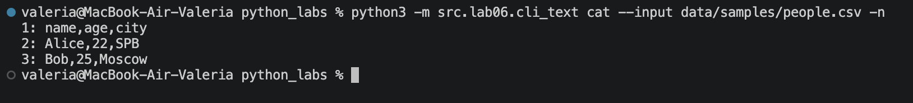
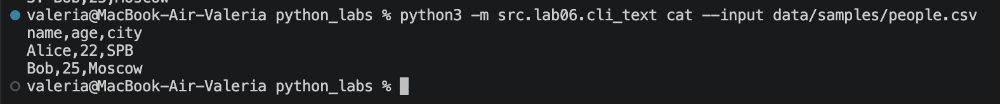
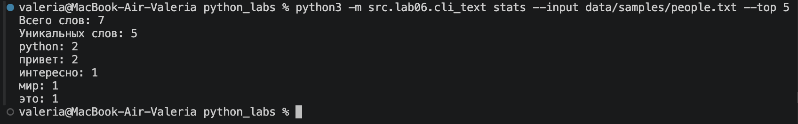
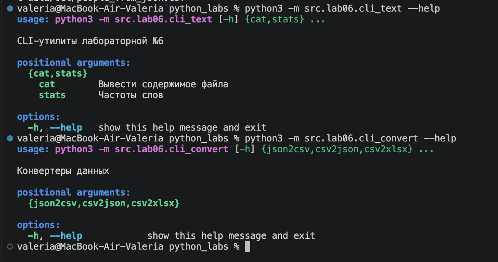
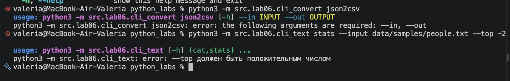

# Лабораторная работа №6

## Задание A (cli_text.py)
Модуль `src/lab06/cli_text.py` предназначен для работы с текстовыми файлами через командную строку и содержит две подкоманды: `cat` и `stats`. Подкоманда `cat --input <путь> [-n]` выводит содержимое файла построчно, а при использовании флага `-n` нумерует строки. Подкоманда `stats --input <путь> [--top N] `анализирует текст, подсчитывает общее количество слов, количество уникальных слов и выводит самые часто встречающиеся слова (по умолчанию 5). Для чтения файлов используется функция read_text из ЛР4, а для обработки текста — функции `normalize`, `tokenize`, `count_freq` и `top_n` из ЛР3. Аргументы командной строки обрабатываются с помощью модуля argparse, также предусмотрена проверка, чтобы значение `--top` было положительным числом. Запуск программы выполняется через функцию `main()`.

```python
import argparse
from src.lab04.io_txt_csv import read_text
from src.lib.text import normalize, tokenize, count_freq, top_n


def main():
    parser = argparse.ArgumentParser(description="CLI-утилиты лабораторной №6")
    subparsers = parser.add_subparsers(dest="command")

    cat_parser = subparsers.add_parser("cat", help="Вывести содержимое файла")
    cat_parser.add_argument("--input", required=True)
    cat_parser.add_argument("-n", action="store_true", help="Нумеровать строки")

    stats_parser = subparsers.add_parser("stats", help="Частоты слов")
    stats_parser.add_argument("--input", required=True)
    stats_parser.add_argument("--top", type=int, default=5)

    args = parser.parse_args()

    if args.command == "cat":
        text = read_text(args.input)
        lines = text.splitlines()

        number = 1
        for line in lines:
            if args.n:
                print(f"{number}: {line}")
            else:
                print(line)
            number += 1

    elif args.command == "stats":
        if args.top <= 0:
            parser.error("--top должен быть положительным числом")

        text = read_text(args.input)
        text = normalize(text)
        tokens = tokenize(text)
        freq = count_freq(tokens)

        print(f"Всего слов: {len(tokens)}")
        print(f"Уникальных слов: {len(freq)}")

        top_words = top_n(freq, n=args.top)

        for word, count in top_words:
            print(f"{word}: {count}")


if __name__ == "__main__":
    main()
```

## Способ запуска

```bash
Все команды выполняются из корневой папки python_labs через терминал VS Code. Для запуска используется python3 -m.
```
## Сценарии проверки

**1. cat — вывод содержимого файла**

Команда для вывода файла с нумерацией строк:

```bash
python3 -m src.lab06.cli_text cat --input data/samples/people.csv -n
```

**Результат:**


Команда для вывода файла без нумерации:

```bash
python3 -m src.lab06.cli_text cat --input data/samples/people.csv
```

**Результат:**


**2. stats — подсчёт частоты слов**

Для проверки используется файл `data/samples/people.txt.`

Команда для вывода пяти самых частых слов:

```bash
python3 -m src.lab06.cli_text stats --input data/samples/people.txt --top 5
```
**Результат:**


## Задание B (cli_convert.py)
Модуль `src/lab06/cli_convert.py` предназначен для преобразования файлов через командную строку и содержит три подкоманды: `json2csv`, `csv2json` и `csv2xlsx`. Подкоманда `json2csv` преобразует JSON-файл в `CSV`, `csv2json` выполняет обратное преобразование, а `csv2xlsx` создаёт Excel-файл из `CSV`. Для каждой подкоманды используются два обязательных параметра: `--in` для указания входного файла и `--out` для указания выходного. Программа использует функции `json_to_csv`, `csv_to_json` и `csv_to_xlsx` из ЛР5. Для обработки аргументов применяется модуль `argparse`, а запуск выполняется через функцию `main()`.
```python
import argparse

from src.lab05.json_csv import json_to_csv, csv_to_json
from src.lab05.csv_xlsx import csv_to_xlsx


def main():
    parser = argparse.ArgumentParser(description="Конвертеры данных")
    sub = parser.add_subparsers(dest="cmd")
    
    p1 = sub.add_parser("json2csv")
    p1.add_argument("--in", dest="input", required=True)
    p1.add_argument("--out", dest="output", required=True)

    p2 = sub.add_parser("csv2json")
    p2.add_argument("--in", dest="input", required=True)
    p2.add_argument("--out", dest="output", required=True)

    p3 = sub.add_parser("csv2xlsx")
    p3.add_argument("--in", dest="input", required=True)
    p3.add_argument("--out", dest="output", required=True)

    args = parser.parse_args()

    if args.cmd == "json2csv":
        json_to_csv(args.input, args.output)
    elif args.cmd == "csv2json":
        csv_to_json(args.input, args.output)
    elif args.cmd == "csv2xlsx":
        csv_to_xlsx(args.input, args.output)

if __name__ == "__main__":
    main()
```
# Сценарии проверки

**1. json2csv — преобразование JSON в CSV**

Команда запуска:

```bash
python3 -m src.lab06.cli_convert json2csv --in data/samples/people.json --out data/out/people_from_json.csv
```

После выполнения команды создаётся файл `data/out/people_from_json.csv`, содержащий данные из исходного JSON-файла.

**2. csv2json — преобразование CSV в JSON**

Команда запуска:

```bash
python3 -m src.lab06.cli_convert csv2json --in data/samples/people.csv --out data/out/people_from_csv.json
```

Программа читает CSV-файл и сохраняет его содержимое в формате JSON.

**3. csv2xlsx — преобразование CSV в XLSX**

Команда запуска:

```bash
python3 -m src.lab06.cli_convert csv2xlsx --in data/samples/people.csv --out data/out/people.xlsx
```

После выполнения команды создаётся файл `data/out/people.xlsx`, который можно открыть в `Excel` или `LibreOffice`. Таблица содержит лист `Sheet1`, а ширина столбцов автоматически подстраивается под содержимое.

# Проверка справки --help

Для просмотра доступных подкоманд используются следующие команды:

```bash
python3 -m src.lab06.cli_text --help
python3 -m src.lab06.cli_convert --help
```


Также можно получить справку по каждой подкоманде:

```bash
python3 -m src.lab06.cli_text cat --help
python3 -m src.lab06.cli_text stats --help
python3 -m src.lab06.cli_convert json2csv --help
python3 -m src.lab06.cli_convert csv2json --help
python3 -m src.lab06.cli_convert csv2xlsx --help
```

**Проверка ошибок**

При отсутствии обязательных параметров `--input`, `--in` или `--out `программа выводит сообщение об ошибке с помощью `argparse`.

Пример:

```bash
python3 -m src.lab06.cli_convert json2csv
```

Также в подкоманде stats предусмотрена проверка положительного значения параметра `--top`.

```bash
python3 -m src.lab06.cli_text stats --input data/samples/people.txt --top -2
```

В результате выводится сообщение:

```bash
error: --top должен быть положительным числом
```

