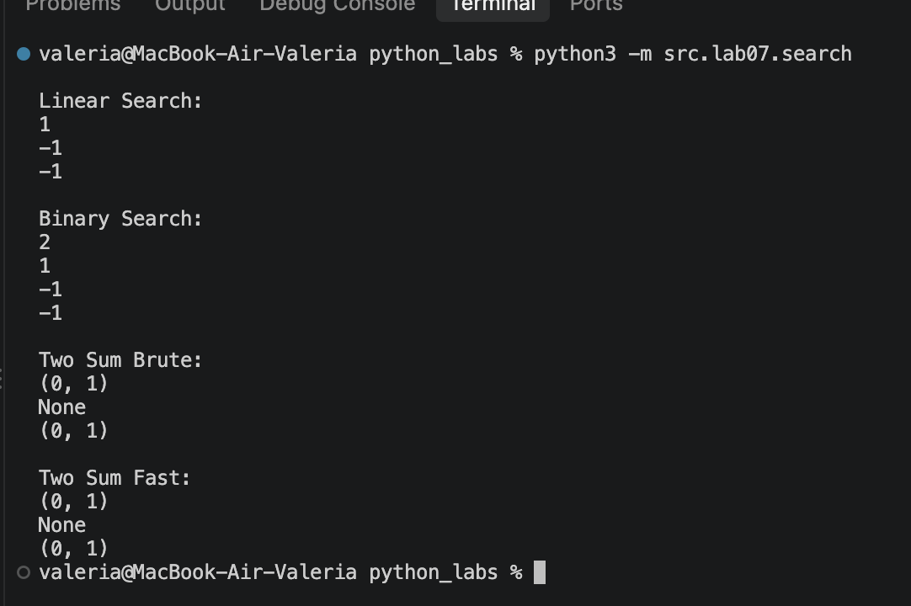
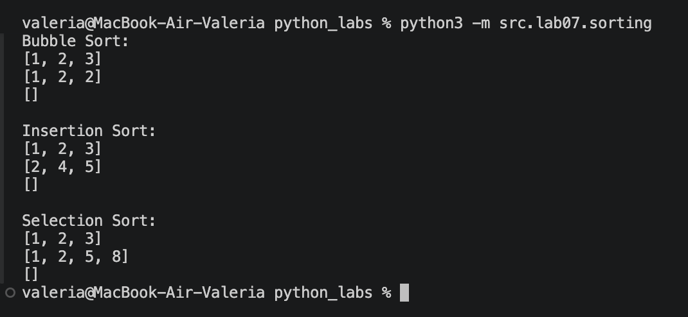
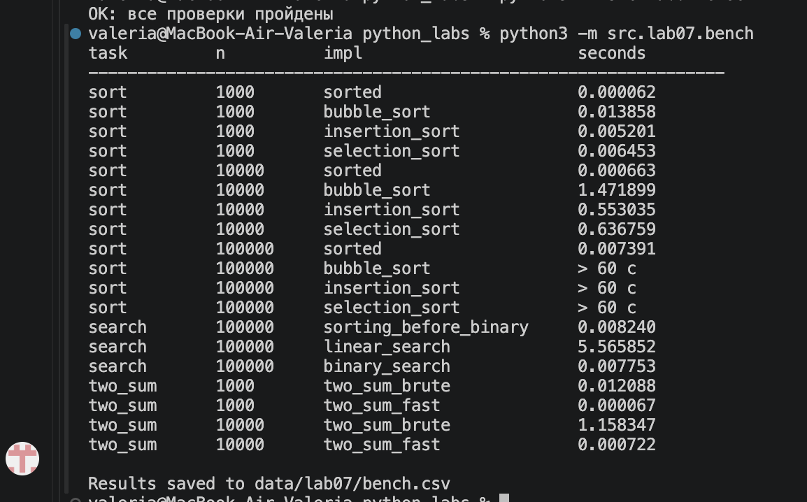
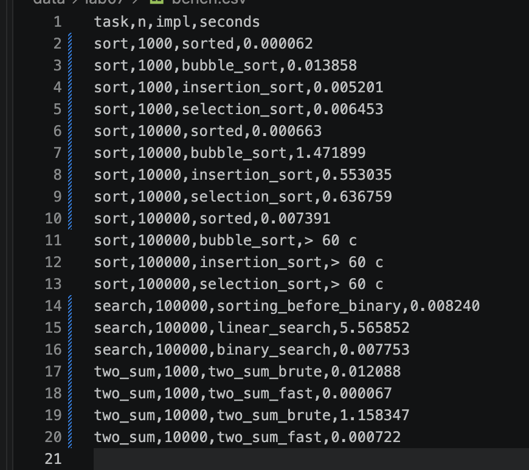

# Лабораторная работа №7

**Поиск, сортировка и измерение времени**

## Цель работы

Реализовать базовые алгоритмы поиска и сортировки без готовых функций, проверить их корректность сравнением с эталоном на случайных данных и измерить время работы на разных объёмах данных.

## Структура проекта

```text
python_labs/
├─ src/
│  ├─ lab04/
│  │  └─ io_txt_csv.py     # write_csv
│  └─ lab07/
│     ├─ search.py
│     ├─ sorting.py
│     ├─ check.py
│     └─ bench.py
├─ data/
│  └─ lab07/
│     └─ bench.csv
└─ images/
   └─ lab07/
```

Все команды выполняются из корневой папки `python_labs`.

---

## Задание A. Поиск (`search.py`)

Модуль содержит четыре функции:

- `linear_search(nums, x)` возвращает индекс первого вхождения `x` или `-1`.
- `binary_search(sorted_nums, x)` возвращает индекс `x` в отсортированном списке или `-1`. На неотсортированном списке результат не определён.
- `two_sum_brute(nums, target)` ищет пару индексов `(i, j)`, `i < j`, с суммой `target` перебором всех пар (`O(n²)`).
- `two_sum_fast(nums, target)` решает ту же задачу за один проход со словарём «значение → индекс» (`O(n)`).

```python
def linear_search(nums, x):
    """
    Возвращает индекс первого вхождения x.
    Если число не найдено, возвращает -1.
    """

    for i in range(len(nums)):
        if nums[i] == x:
            return i
    return -1


def binary_search(sorted_nums, x):
    """
    Ищет число x в отсортированном списке.
    Возвращает индекс или -1.
    На неотсортированном списке результат не определён.
    """
    lo = 0
    hi = len(sorted_nums) - 1

    while lo <= hi:
        mid = (lo + hi) // 2
        if sorted_nums[mid] == x:
            return mid
        elif sorted_nums[mid] < x:
            lo = mid + 1
        else:
            hi = mid - 1

    return -1


def two_sum_brute(nums, target):
    """
    Ищет два числа, сумма которых равна target.
    Возвращает их индексы или None.
    """

    for i in range(len(nums)):
        for j in range(i + 1, len(nums)):
            if nums[i] + nums[j] == target:
                return (i, j)

    return None


def two_sum_fast(nums, target):
    """
    Ищет два числа с суммой target через словарь.
    Возвращает пару индексов или None.
    """

    seen = {}
    for i in range(len(nums)):
        x = nums[i]
        need = target - x

        if need in seen:
            return (seen[need], i)
        seen[x] = i

    return None


if __name__ == "__main__":
    print("\nЛинейный поиск:")
    print(linear_search([4, 2, 7, 2], 2))
    print(linear_search([4, 2, 7, 2], 9))
    print(linear_search([], 5))

    print("\nБинарный поиск:")
    print(binary_search([1, 3, 5, 7, 9], 5))
    print(binary_search([1, 3, 5, 7, 9], 3))
    print(binary_search([1, 3, 5, 7, 9], 10))
    print(binary_search([], 5))

    print("\nTwo Sum Brute:")
    print(two_sum_brute([2, 7, 11, 15], 9))
    print(two_sum_brute([1, 2, 3], 10))
    print(two_sum_brute([4, 4, 8], 8))

    print("\nTwo Sum Fast:")
    print(two_sum_fast([2, 7, 11, 15], 9))
    print(two_sum_fast([1, 2, 3], 10))
    print(two_sum_fast([4, 4, 8], 8))
```

Запуск:

```bash
python3 -m src.lab07.search
```



---

## Задание B. Сортировки (`sorting.py`)

Три квадратичные сортировки: пузырьком, вставками и выбором. Каждая возвращает **новый** список и не меняет исходный (в начале делается копия `nums = list(nums)`). Внутри не используются `sorted`, `.sort()`, `min`, `max`. В пузырьке добавлен флаг `swapped`: если за проход не было обменов, список уже отсортирован и происходит ранний выход.

```python
def bubble_sort(nums):
    """
    Сортирует список по возрастанию методом пузырька.
    Возвращает новый список, исходный не изменяет.
    """

    nums = list(nums)

    for i in range(len(nums)):
        swapped = False

        for j in range(len(nums) - 1 - i):
            if nums[j] > nums[j + 1]:
                nums[j], nums[j + 1] = nums[j + 1], nums[j]
                swapped = True

        if not swapped:
            break

    return nums


def insertion_sort(nums):
    """
    Сортирует список по возрастанию методом вставок.
    Возвращает новый список, исходный не изменяет.
    """

    nums = list(nums)

    for i in range(1, len(nums)):
        key = nums[i]
        j = i - 1

        while j >= 0 and nums[j] > key:
            nums[j + 1] = nums[j]
            j -= 1
        nums[j + 1] = key
    return nums


def selection_sort(nums):
    """
    Сортирует список по возрастанию методом выбора.
    Возвращает новый список, исходный не изменяет.
    """

    nums = list(nums)
    for i in range(len(nums)):
        min_index = i
        for j in range(i + 1, len(nums)):
            if nums[j] < nums[min_index]:
                min_index = j

        nums[i], nums[min_index] = nums[min_index], nums[i]

    return nums


if __name__ == "__main__":
    print("\nBubble Sort:")
    print(bubble_sort([3, 1, 2]))
    print(bubble_sort([2, 2, 1]))
    print(bubble_sort([]))

    print("\nInsertion Sort:")
    print(insertion_sort([3, 1, 2]))
    print(insertion_sort([5, 2, 4]))
    print(insertion_sort([]))

    print("\nSelection Sort:")
    print(selection_sort([3, 1, 2]))
    print(selection_sort([5, 2, 8, 1]))
    print(selection_sort([]))
```

Запуск:

```bash
python3 -m src.lab07.sorting
```



---

## Задание C. Проверка против эталона (`check.py`)

Модуль сравнивает написанные функции с эталоном на случайных данных (`random`, длина списка от 0 до 50, значения от −100 до 100, с повторами):

- `check_sorting(fn, trials=100)` сравнивает `fn(nums)` с `sorted(nums)` и проверяет, что исходный список не изменился.
- `check_search()` сравнивает `linear_search` с `list.index` (а `-1` с `ValueError`), а `binary_search` проверяет на отсортированных списках, включая отсутствующие значения и крайние элементы. Добавлены граничные случаи: пустой список, первый и последний элемент.
- `check_two_sum(trials=100)` проверяет, что оба решения находят пару с нужной суммой (или оба возвращают `None`).

При расхождении выбрасывается `AssertionError`.

```python
import random

from src.lab07.search import linear_search, binary_search, two_sum_brute, two_sum_fast
from src.lab07.sorting import bubble_sort, insertion_sort, selection_sort


def check_sorting(fn, trials=100):
    """
    Проверяет правильность сортировки.
    Также проверяет, что исходный список не изменился.
    """

    for _ in range(trials):
        n = random.randint(0, 50)
        nums = [random.randint(-100, 100) for _ in range(n)]

        original = list(nums)
        result = fn(nums)

        # Сравниваем результат с обычной сортировкой Python
        assert result == sorted(nums), f"Ошибка сортировки: {nums}"

        # Проверяем, что исходный список не изменился
        assert nums == original, "Исходный список изменился"


def check_search():
    """
    Проверяет линейный и бинарный поиск.
    """

    for _ in range(100):
        n = random.randint(0, 50)
        nums = [random.randint(-100, 100) for _ in range(n)]
        x = random.randint(-100, 100)

        # Получаем ожидаемый результат линейного поиска
        try:
            expected = nums.index(x)
        except ValueError:
            expected = -1

        result = linear_search(nums, x)

        assert result == expected, "Ошибка линейного поиска"

        # Бинарный поиск выполняем на отсортированном списке
        sorted_nums = sorted(nums)
        binary_result = binary_search(sorted_nums, x)

        if x not in sorted_nums:
            assert binary_result == -1, "Ошибка бинарного поиска"
        else:
            assert 0 <= binary_result < len(sorted_nums)
            assert sorted_nums[binary_result] == x, "Ошибка бинарного поиска"

    # Проверяем граничные случаи
    nums = [1, 3, 5, 7, 9]

    assert binary_search(nums, 1) == 0
    assert binary_search(nums, 9) == 4
    assert binary_search(nums, 10) == -1
    assert binary_search([], 5) == -1

    assert linear_search([], 5) == -1
    assert linear_search([2, 4, 2], 2) == 0


def check_two_sum(trials=100):
    """
    Проверяет две функции поиска пары чисел.
    """

    for _ in range(trials):
        n = random.randint(0, 50)
        nums = [random.randint(-100, 100) for _ in range(n)]
        target = random.randint(-100, 100)

        brute = two_sum_brute(nums, target)
        fast = two_sum_fast(nums, target)

        # Если первая функция не нашла пару,
        # вторая тоже должна вернуть None
        if brute is None:
            assert fast is None, "Ошибка Two Sum Fast"
        else:
            # Проверяем индексы и сумму первой функции
            i, j = brute

            assert 0 <= i < j < len(nums)
            assert nums[i] + nums[j] == target

            # Вторая функция тоже должна найти пару
            assert fast is not None, "Ошибка Two Sum Fast"

            i, j = fast

            assert 0 <= i < j < len(nums)
            assert nums[i] + nums[j] == target

    # Дополнительные проверки
    assert two_sum_brute([2, 7, 11, 15], 9) == (0, 1)
    assert two_sum_fast([2, 7, 11, 15], 9) == (0, 1)

    assert two_sum_brute([1, 2, 3], 10) is None
    assert two_sum_fast([1, 2, 3], 10) is None

    assert two_sum_brute([], 5) is None
    assert two_sum_fast([], 5) is None


if __name__ == "__main__":

    # Проверяем три сортировки
    check_sorting(bubble_sort)
    check_sorting(insertion_sort)
    check_sorting(selection_sort)

    # Проверяем поиск
    check_search()

    # Проверяем Two Sum
    check_two_sum()

    print("OK: все проверки пройдены")
```

Запуск:

```bash
python3 -m src.lab07.check
```


---

## Задание D. Бенчмарк (`bench.py`)

Замеры выполняются через `timeit` (один запуск, `number=1`). Данные генерируются один раз при `random.seed(42)` и подаются всем алгоритмам одинаковые.

- **Сортировки:** три собственные сортировки против `sorted` при n = 1 000 / 10 000 / 100 000. Для n = 100 000 квадратичные сортировки не запускались: по оценке это порядка 10¹⁰ шагов, поэтому в таблице стоит `> 60 с`.
- **Поиск:** линейный и бинарный поиск, 10 000 запросов к списку из 100 000 элементов. Сортировка перед бинарным поиском вынесена в отдельную строку `sorting_before_binary`.
- **Two Sum:** `two_sum_brute` против `two_sum_fast` при n = 1 000 / 10 000. Искомая сумма гарантированно существует (это сумма двух последних элементов).

Результат выводится таблицей в консоль и сохраняется в `data/lab07/bench.csv` (колонки `task,n,impl,seconds`).

```python
import random
import timeit

from src.lab07.search import linear_search, binary_search, two_sum_brute, two_sum_fast
from src.lab07.sorting import bubble_sort, insertion_sort, selection_sort
from src.lab04.io_txt_csv import write_csv


def bench_sorts(n):
    data = [random.randint(-1000, 1000) for _ in range(n)]
    rows = []

    t = timeit.timeit(lambda: sorted(data), number=1)
    rows.append(("sort", n, "sorted", t))

    if n < 100000:
        t = timeit.timeit(lambda: bubble_sort(data), number=1)
        rows.append(("sort", n, "bubble_sort", t))

        t = timeit.timeit(lambda: insertion_sort(data), number=1)
        rows.append(("sort", n, "insertion_sort", t))

        t = timeit.timeit(lambda: selection_sort(data), number=1)
        rows.append(("sort", n, "selection_sort", t))
    else:
        rows.append(("sort", n, "bubble_sort", "> 60 с"))
        rows.append(("sort", n, "insertion_sort", "> 60 с"))
        rows.append(("sort", n, "selection_sort", "> 60 с"))

    return rows


def bench_search():
    nums = [random.randint(0, 100000) for _ in range(100000)]
    queries = [random.randint(0, 100000) for _ in range(10000)]
    rows = []

    t = timeit.timeit(lambda: sorted(nums), number=1)
    rows.append(("search", 100000, "sorting_before_binary", t))

    sorted_nums = sorted(nums)

    t = timeit.timeit(
        lambda: [linear_search(nums, x) for x in queries],
        number=1
    )
    rows.append(("search", 100000, "linear_search", t))

    t = timeit.timeit(
        lambda: [binary_search(sorted_nums, x) for x in queries],
        number=1
    )
    rows.append(("search", 100000, "binary_search", t))

    return rows


def bench_two_sum(n):
    nums = random.sample(range(1, 1000000000), n)
    target = nums[-2] + nums[-1]
    rows = []

    t = timeit.timeit(lambda: two_sum_brute(nums, target), number=1)
    rows.append(("two_sum", n, "two_sum_brute", t))

    t = timeit.timeit(lambda: two_sum_fast(nums, target), number=1)
    rows.append(("two_sum", n, "two_sum_fast", t))

    return rows


if __name__ == "__main__":
    random.seed(42)
    results = []

    for n in [1000, 10000, 100000]:
        results.extend(bench_sorts(n))

    results.extend(bench_search())

    for n in [1000, 10000]:
        results.extend(bench_two_sum(n))

    print(f"{'task':<12} {'n':<10} {'impl':<25} {'seconds':<15}")
    print("-" * 65)

    csv_rows = []

    for task, n, impl, seconds in results:
        if isinstance(seconds, float):
            seconds_text = f"{seconds:.6f}"
        else:
            seconds_text = seconds

        print(f"{task:<12} {n:<10} {impl:<25} {seconds_text:<15}")
        csv_rows.append((task, n, impl, seconds_text))

    write_csv(
        csv_rows,
        "data/lab07/bench.csv",
        header=("task", "n", "impl", "seconds")
    )

    print("\nРезультаты сохранены в data/lab07/bench.csv")
```

Запуск:

```bash
python3 -m src.lab07.bench
```



### Таблица бенчмарка (`data/lab07/bench.csv`)



---

## Выводы

**Сортировки.** Пузырёк, вставки и выбор имеют сложность `O(n²)`: при росте `n` в 10 раз число шагов растёт в 10² = 100 раз, и в замерах время `bubble_sort` выросло с ___ с до ___ с (примерно в ___ раз). У встроенной `sorted` (Timsort) сложность `O(n log n)`: при росте `n` в 10 раз число шагов растёт примерно в 12–13 раз, и в замерах время выросло с ___ с до ___ с (в ___ раз). Поэтому на n = 100 000 квадратичные сортировки требуют порядка 10¹⁰ шагов, и запускать их не имеет смысла (`> 60 с`), а `sorted` справляется за ___ с. Из квадратичных сортировок быстрее остальных оказалась ___ , медленнее всех ___ .

**Поиск.** Бинарный поиск работает только на отсортированном списке: он сравнивает `x` со средним элементом и отбрасывает половину диапазона, а на неотсортированных данных это отбрасывание теряет искомый элемент, и результат неверен. Но сортировка стоит `O(n log n)`, а один линейный поиск только `O(n)`, поэтому для одного запроса сортировать список ради бинарного поиска невыгодно. Сортировка окупается, когда запросов много: в шагах это примерно после `log₂ n ≈ 17` запросов для n = 100 000. В замерах на 10 000 запросов линейный поиск занял ___ с, бинарный ___ с, а сортировка перед ним ___ с, то есть суммарно (сортировка + бинарный поиск) значительно быстрее, чем линейный поиск. Аналогично `two_sum_fast` (`O(n)`) на n = 10 000 работает за ___ с против ___ с у `two_sum_brute` (`O(n²)`).

## Результат `check.py`

`check.py` проводит по 100 случайных прогонов для каждой из трёх сортировок (300 прогонов), 100 прогонов для поиска и 100 для Two Sum, а также набор граничных случаев (пустой список, крайние элементы, отсутствующее значение, дубликаты). Расхождений с эталоном не обнаружено, все проверки пройдены, программа завершается сообщением `OK: все проверки пройдены`.